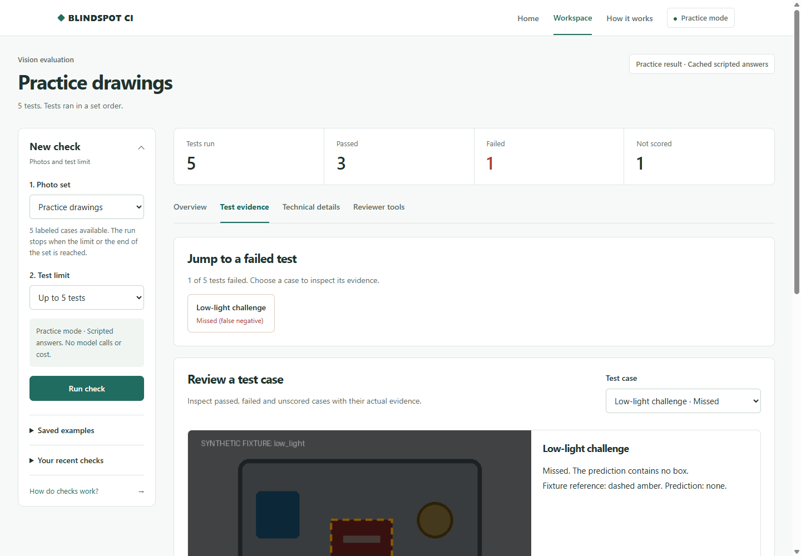
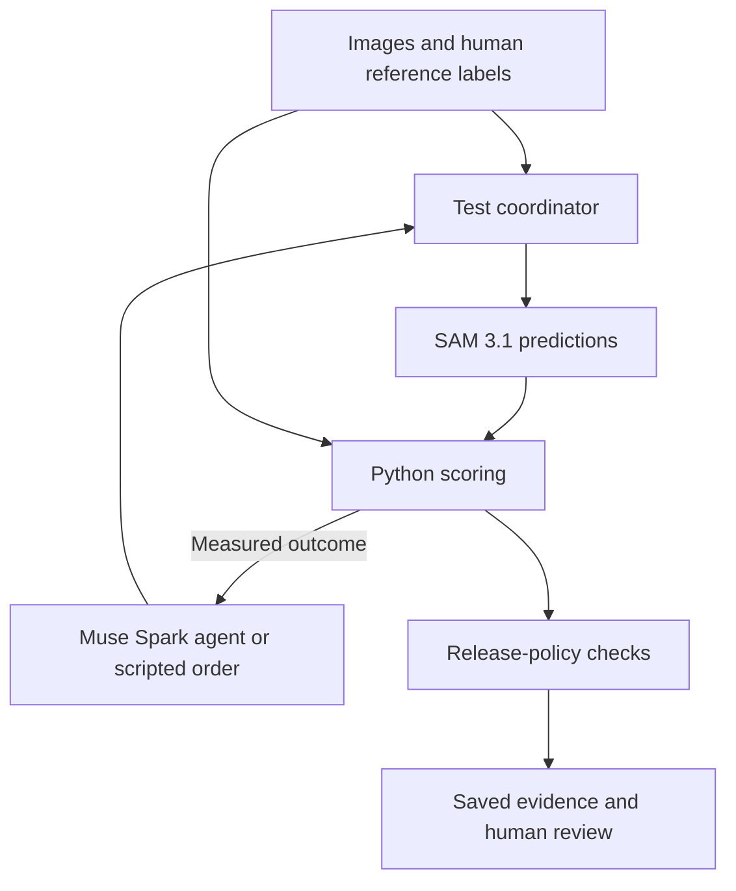

# BLINDSPOT CI

Find vision-model failures. Keep the evidence.

An agent-enabled evaluation workspace for vision engineers and QA teams. Test human-labeled cases, inspect missed objects and false alarms, and export a report that explains what happened.

Muse Spark can choose the next test. SAM 3.1 produces predictions. Python calculates the scores. A person reviews the release decision.

[Quick start](#quick-start) | [Developer guide](docs/DEVELOPER_GUIDE.md) | [Architecture](docs/ARCHITECTURE.md) | [Judge overview](docs/HACKATHON_OVERVIEW.md) | [Documentation](docs/README.md)



The screenshot shows practice drawings and scripted answers. They demonstrate the software, not model performance. BLINDSPOT CI is an evaluation harness, not a benchmark or a safety approval.

## What you can do

- Test a prepared collection of images against references supplied by people.
- Let the Muse Spark agent select tests, or use a repeatable scripted order.
- Inspect misses, false alarms, box disagreements, unknowns and execution errors separately.
- Review condition coverage, sample limitations and a deterministic release-policy decision.
- Attach reviewer notes and use optional image, voice and audit tools.
- Reopen saved runs and export Markdown or JSON evidence.

The current application uses a dataset selector, local importer and local labeler. Browser photo upload and project creation are not implemented. Prepared video studies use the video and temporal-evaluation tools.

Coding agents can run the same workflow through the CLI. Use install-skill to add the bundled workflow to a Codex or Claude Code project, then use experiment --json and report --json for machine-readable evidence. See [agent integration](docs/AGENT_INTEGRATION.md) for commands and tested boundaries.

## Quick start

Requires Git and Python 3.11 or newer. The practice workflow needs no GPU or model credential and makes no model call. Installing dependencies requires internet access.

### Windows PowerShell

```powershell
git clone https://github.com/fahaamqureshi/BLINDSPOT_CI.git
cd BLINDSPOT_CI
py -3 -m venv .venv
.\.venv\Scripts\python.exe -m pip install -e .
.\.venv\Scripts\python.exe -m blindspot_ci.cli init ../blindspot-workspace
.\.venv\Scripts\python.exe -m blindspot_ci.cli --workspace ../blindspot-workspace doctor --mock
.\.venv\Scripts\python.exe -m blindspot_ci.cli --workspace ../blindspot-workspace serve --mock
```

### macOS or Linux

```bash
git clone https://github.com/fahaamqureshi/BLINDSPOT_CI.git
cd BLINDSPOT_CI
python3 -m venv .venv
.venv/bin/python -m pip install -e .
.venv/bin/python -m blindspot_ci.cli init ../blindspot-workspace
.venv/bin/python -m blindspot_ci.cli --workspace ../blindspot-workspace doctor --mock
.venv/bin/python -m blindspot_ci.cli --workspace ../blindspot-workspace serve --mock
```

Open [the app](http://127.0.0.1:8000/app), keep Practice drawings selected, and press Run check. With the five-test limit, the deterministic fixture run produces three passes, one failure and one unknown. Its decision is DEMO_ONLY.

Inspect the failure in Test evidence, add a note in Reviewer tools, then download the report. Your data and runs stay in the separate workspace. The --mock option disables dotenv loading and live calls before configuration loads. No environment file is needed. See the [developer guide](docs/DEVELOPER_GUIDE.md) for imports, commands, extension boundaries and troubleshooting.

## How the agent fits

Agent mode is a bounded choose, observe and choose-again loop. Muse Spark sees case descriptions and prior measured outcomes. It can request an available test or finish. The server validates its tool calls. Reference boxes stay outside the planner input.



The browser is HTML, CSS and JavaScript. A Python FastAPI server coordinates tests, model adapters, scoring and local file storage. The [architecture guide](docs/ARCHITECTURE.md) explains the full request path, agent boundaries, caching and data ownership.

| Component | Responsibility |
| --- | --- |
| Muse Spark 1.3 | Select the next case through validated function calls in agent mode |
| SAM 3.1 | Produce the object boxes and masks being evaluated |
| Muse Image | Create stress variants that require reference review |
| Muse Voice Transcribe | Turn spoken reviewer input into text |
| Muse Wonder | Explain a completed run without changing its scores |
| Python evaluator | Compare predictions with references and calculate outcomes |

Not every run uses an AI planner. In Technical details, MUSE_SPARK_AGENT identifies agent selection and MOCK_POLICY identifies scripted selection. LIVE_META identifies a real model response, not the planner used.

## Read the result correctly

| Decision | Meaning |
| --- | --- |
| DEMO_ONLY | Scripted, synthetic or derived evidence demonstrates the workflow |
| NEEDS_REVIEW | Evidence is incomplete, uncertain or insufficient for the configured policy |
| NO_GO | A required condition fails the configured release policy |
| GO_CANDIDATE | Configured checks passed; a person still makes the decision |

A passing image meets that case's comparison rule. It does not establish general accuracy. Unknown references and execution errors are not counted as model misses. No recorded run has established a safety or deployment approval.

## Recorded evidence

| Study | Observation | What is included |
| --- | --- | --- |
| COCO photographs | 132 cases; low light passed 6 of 10 and small objects 19 of 24; NO_GO | Saved report a165cd6773cd433a in fixtures/examples; fixed scripted order |
| DAVIS video frames | 112 frames from 14 clips; NEEDS_REVIEW | Saved report 8f6003378706480a in fixtures/examples; fixed scripted order |
| Fresh judge-demo study | Eight agent-selected cases passed; a separate complete twenty-case suite found three failures outside that selection | Documented local study; raw media and reports are not bundled |

These are separate, limited studies. The COCO and DAVIS results were not produced by the Muse Spark planner. The fresh study demonstrates why an agent-selected sample cannot replace full-suite coverage. See [recorded results](docs/real-results.md), the [fresh demo guide](docs/JUDGE_DEMO_GUIDE.md) and the [current video case study](docs/REAL_WORLD_VIDEO_DEMO.md) for limitations and provenance.

Training overlap is unknown or unverified, frames from the same clip are correlated, and independent second-labeler review remains incomplete. Video observations without human references are not accuracy-scored. A model was evaluated, not repaired or certified.

## Replay saved evidence without a model call

Open Saved examples in the workspace and select a report. The public reports are included, while source-photo availability varies. A box-only fallback explicitly identifies a missing photo.

For a command-line replay, use the public fixture directory:

```powershell
$env:DOTENV_DISABLED = "1"
$env:BLINDSPOT_RUNS_DIR = "fixtures/examples"
.\.venv\Scripts\python.exe -m blindspot_ci.cli release-gate --run a165cd6773cd433a
$env:BLINDSPOT_RUNS_DIR = "artifacts/runs"
```

NO_GO intentionally returns exit code 1. It is a policy result, not a crash. Run outputs are otherwise written locally under artifacts/runs.

## Development checks

Set a mock-only verification environment, then run:

```powershell
$env:DOTENV_DISABLED = "1"
$env:BLINDSPOT_PROVIDER = "mock"
$env:BLINDSPOT_PLANNER = "heuristic"
$env:BLINDSPOT_DATASET = "synthetic"
$env:LIVE_API_ENABLED = "false"
.\.venv\Scripts\python.exe -m pip install -e ".[dev]"
.\.venv\Scripts\python.exe scripts/check.py
.\.venv\Scripts\python.exe scripts/audit_mock.py
.\.venv\Scripts\python.exe -m pip wheel . --no-deps --wheel-dir dist
.\.venv\Scripts\python.exe scripts/verify_wheel.py dist/blindspot_ci-0.1.0-py3-none-any.whl
```

On macOS or Linux, set the same environment values with export and replace the Python executable with .venv/bin/python. The completion gate covers lint, tests, documentation style, attribution and secret checks. The wheel check runs outside the checkout with live access disabled and exercises workspace initialization, offline diagnostics and practice evaluation. GitHub Actions runs the completion and packaging checks on Python 3.11 and 3.13.

## Repository map

| Path | Contents |
| --- | --- |
| blindspot_ci/web | Landing page, workspace, guide and shared styles |
| blindspot_ci/api.py | FastAPI routes and application coordination |
| blindspot_ci/experiment | Planner loop, case validation, scoring, policy and reports |
| blindspot_ci/providers | Mock provider and Meta model adapters |
| fixtures | Scripted answers, public saved reports and policies |
| datasets | Public practice assets; private collections are ignored |
| tests | Unit, API, contract and evaluation regressions |
| scripts | Local audit, data, packaging and validation tools |
| docs | Architecture, setup, evidence, demo and readiness documentation |

## Scope and next steps

The default and documented setup is mock mode. Live operation requires separate explicit configuration, credentials and spending controls. See the [setup guide](docs/GETTING_STARTED.md) and [API contracts](docs/API_CONTRACTS.md). Do not use a credentialed server as an unauthenticated public service.

The current release is a local engineering tool. Browser upload, project management, sign-in and continuous camera monitoring are outside its implemented product flow. The public-camera demonstration was a separate bounded snapshot experiment. Review [readiness](docs/SUBMISSION_READINESS.md), [deployment guidance](docs/free-deployment.md) and [the judge overview](docs/HACKATHON_OVERVIEW.md) before preparing a submission or a public demo.

## License

Project source is available under the [MIT License](LICENSE). Third-party datasets, photographs, video, audio and music retain their own terms. They are not covered by the project's source-code license. Downloaded or private media is not included in the default distribution.
