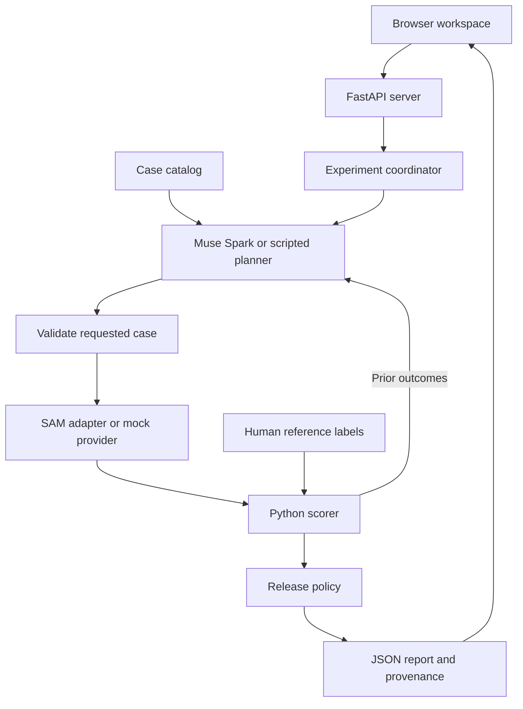

# Architecture

[Documentation](README.md) | [Setup](GETTING_STARTED.md) | [Judge overview](HACKATHON_OVERVIEW.md)

## What this product is

BLINDSPOT CI is an evaluation harness for vision models. It helps an engineer ask whether a model succeeds on a specific collection of human-labeled cases, find failures and preserve evidence for review. It does not train or repair the model.

The agent is an optional part of the system. In agent mode, Muse Spark chooses tests through function calls and observes their measured outcomes. In scripted mode, a repeatable policy chooses the tests. Both paths use the same scoring and reporting code.

## Request path

1. The user selects a prepared dataset and a test limit.
2. The coordinator exposes available case descriptions to the selected planner.
3. The planner requests a test. The server checks that the case exists and has not already run.
4. The provider returns predictions or an explicit error. Mock mode returns fixtures.
5. Python compares predictions against human references and records the outcome.
6. The planner observes previous outcomes before choosing again, within the configured limit.
7. The release policy examines evidence and coverage. The server saves a report for human review.

Reference boxes are not supplied to the planner as answers. Model text cannot overwrite the Python score or the release-policy decision.

## Agent boundaries

The Muse Spark planner has two actions: choose_next_test with a case identifier and reason, or finish_testing with a reason. The server validates each action. This is a bounded evaluation loop, not an agent with arbitrary computer access.

An agent may miss an important case when its test budget is small. The fresh judge-demo study illustrates this: eight selected cases passed, while the separate complete twenty-case suite found three failures outside that selection. Always report configured cases and tested coverage separately.

## Model responsibilities

| Component | Input | Output and boundary |
| --- | --- | --- |
| Muse Spark 1.3 | Case descriptions and prior outcomes | Validated next-test or finish action |
| SAM 3.1 | Image or prepared video input and task prompt | Predictions being evaluated |
| Muse Image | A requested image transformation | A derivative requiring reference review before scoring |
| Muse Voice Transcribe | Reviewer audio | Text for reviewer input; microphone capture is a separate concern |
| Muse Wonder | Completed report | Explanation that cannot change the stored scores |
| Python | Predictions, references and policy | Reproducible comparisons and policy decision |

These are separate capabilities. A normal image evaluation does not invoke every model.

## Scoring and decisions

The core image evaluation uses box comparisons, including intersection over union, with a default threshold of 0.35. This is not a comprehensive pixel-mask benchmark. Human references define whether an object is visible, absent or unknown. Prediction misses, false alarms, uncertain references and execution errors remain distinguishable.

Unknown references and execution errors are not ordinary scored model failures. Insufficient or uncertain evidence can produce NEEDS_REVIEW. A failed required condition can produce NO_GO. Scripted or synthetic demonstrations produce DEMO_ONLY. GO_CANDIDATE still requires a person's decision and does not certify safety.

See [evaluation protocol](EVALUATION_PROTOCOL.md) and [release policy](release-gate.md) for the precise rules and limitations.

## Application and storage

| Layer | Implementation |
| --- | --- |
| Interface | Repository-owned HTML, CSS and JavaScript in [web](../blindspot_ci/web) |
| HTTP API | [FastAPI application](../blindspot_ci/api.py) |
| Evaluation | [Experiment package](../blindspot_ci/experiment) |
| Model access | [Provider adapters](../blindspot_ci/providers) |
| Persistence | Local JSON reports, cache entries and provenance records |
| Verification | [Tests](../tests), [completion gate](../scripts/check.py) and installed-wheel checks |

Reports record their source, configuration and provenance so a replay can be distinguished from a fresh model response. Caching can reuse prior responses; replaying a saved report does not make a new model call. The browser shows source and planner details separately.

MOCK_FIXTURE identifies scripted provider evidence. LIVE_META identifies a real provider response. MUSE_SPARK_AGENT identifies agent selection. MOCK_POLICY identifies scripted selection. A real provider response alone does not establish that an agent selected its case.

## Product boundaries

The workspace selects datasets prepared through local tools. It has no browser photo upload, project-creation flow or production sign-in system. Video and temporal studies use separate preparation and evaluation tools. The public-camera study was a bounded snapshot experiment, not an always-on monitoring service in the workspace.

The supported first-run path is local mock mode with dotenv loading disabled. Live use requires separately authorized credentials and configuration. Private datasets, downloaded third-party media and secrets are excluded from the public package. A credentialed local server should not be exposed as an unauthenticated public service.
