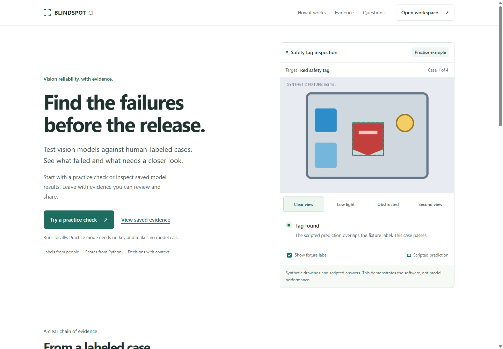

# First walkthrough

[Documentation](README.md) | [Architecture](ARCHITECTURE.md)

## Install and start

Follow the [Windows or macOS/Linux quick start](../README.md#quick-start). You need Git, Python 3.11 or newer and internet access to install dependencies. The first run uses bundled drawings and scripted answers, so no GPU or model credential is needed.

Use the Python executable inside the virtual environment directly. This avoids shell activation issues on Windows. Keep DOTENV_DISABLED=1, BLINDSPOT_PROVIDER=mock, BLINDSPOT_PLANNER=heuristic, BLINDSPOT_DATASET=synthetic and LIVE_API_ENABLED=false for this walkthrough.

The server starts at [the home page](http://127.0.0.1:8000/). Open [the workspace](http://127.0.0.1:8000/app) to begin.



## Your first check

1. Select Practice drawings in the workspace.
2. Keep the limit at five tests and press Run check.
3. Read the overview: three passes, one failure and one unknown. DEMO_ONLY means these are practice results.
4. Open Test evidence and inspect the deliberate low-light miss. Compare the reference with the prediction.
5. Inspect the unknown case. An uncertain reference is different from a model failure.
6. Open Technical details to inspect the source, selected order and provenance.
7. Use Reviewer tools to attach a note to the intended case.
8. Download the report and reopen the run through recent results.

The fixed fixture demonstrates the workflow. These numbers are not SAM performance, and the scripted order is not evidence of Muse Spark reasoning.

## Reopen recorded model evidence

Use Saved examples to inspect the bundled COCO and DAVIS reports without a model call. Some original photographs are not distributed. The interface identifies missing photos and can display recorded boxes without implying that a photo is present.

The [README replay command](../README.md#replay-saved-evidence-without-a-model-call) also reads a saved report. NO_GO exits with code 1 intentionally. Restore the normal runs directory after inspecting the fixture directory.

Recorded reports describe earlier executions. Their presence does not mean your current server is connected to a model provider. Check source and planner fields separately.

## Use your own cases

The browser selects prepared datasets. Importing images and creating reference labels use local tools; browser uploads are not implemented. Read [dataset preparation](dataset.md) before adding cases. References must come from a person. Unknown labels should remain unknown until reviewed.

The [evaluation protocol](EVALUATION_PROTOCOL.md) explains sample limitations and scoring. Generated image variants need reference review. Video observations without human references should be presented as observations rather than accuracy results.

## Common setup issues

| Symptom | Action |
| --- | --- |
| Python is missing or too old | Install Python 3.11 or newer, then recreate the virtual environment |
| Windows blocks activation | Use .venv/Scripts/python.exe directly, as in the quick start |
| A dependency is missing | Run the editable install using the same virtual-environment Python used to start the app |
| Port 8000 is occupied | Set BLINDSPOT_PORT to an unused port before starting the server, then open that port |
| A saved report has no photograph | Read the missing-photo notice; do not interpret a box-only view as a loaded image |
| The practice result says DEMO_ONLY | Expected: it is a scripted software demonstration |
| A release-gate command exits with code 1 | Read its policy decision; NO_GO is an intentional result |

To use port 8055 in PowerShell:

```powershell
$env:BLINDSPOT_PORT = "8055"
.\.venv\Scripts\python.exe -m blindspot_ci.cli serve
```

On macOS or Linux use export BLINDSPOT_PORT=8055 and the .venv/bin/python executable.

## Development and live operation

Install the development extra and run the [documented checks](../README.md#development-checks) before publishing changes. The mock audit exercises HTTP behavior, caching, export and restart without using private datasets.

Live operation is a separate configuration step with credentials, explicit authorization and spending controls. It is not necessary for setup, a practice demonstration or saved-report replay. This guide does not enable live calls. See [API contracts](API_CONTRACTS.md), [agent workflow](agent-workflow.md) and [readiness](SUBMISSION_READINESS.md) before planning a live evaluation.
